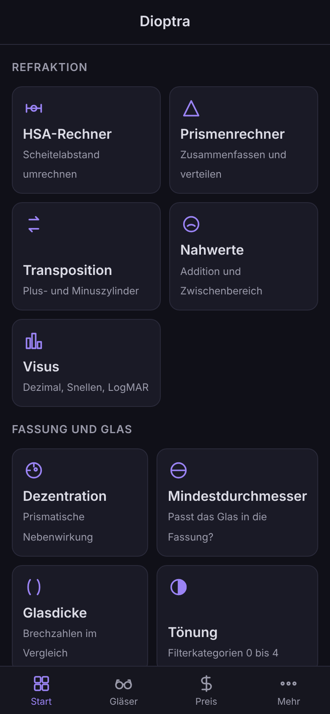
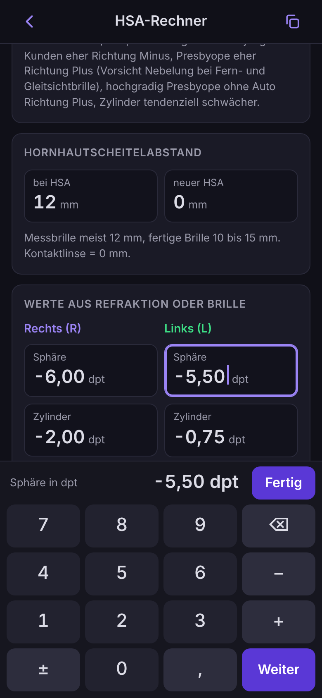
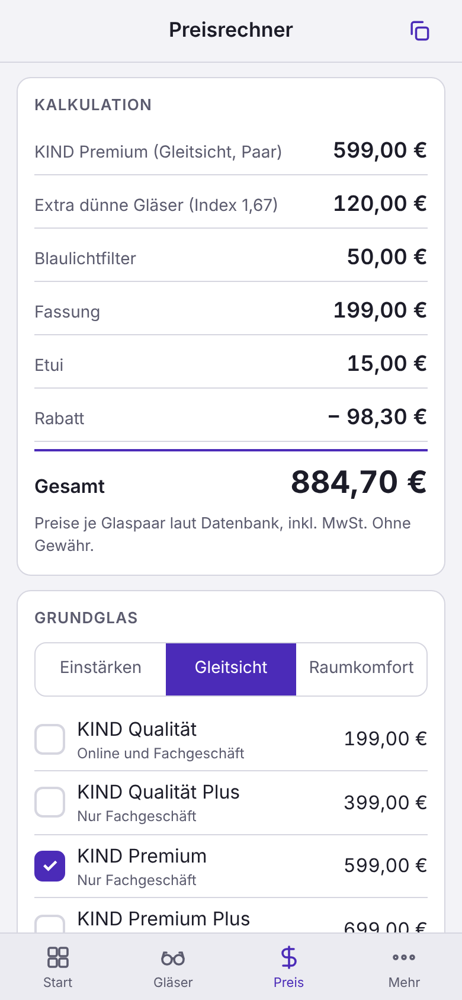

# Dioptra

**Rechner, Preiskalkulation und Gläserdatenbank für Augenoptik und Hörakustik.
Läuft ohne Installation und ohne Netz.**

Spendenfinanzierte Freeware, kostenlos für private und gewerbliche Nutzung ohne Limits.

---

## Worum es geht

Es braucht immer dieselben Rechnungen: Werte auf einen anderen Hornhautscheitelabstand umrechnen, Prismen
zusammenfassen und verteilen, Zylinder transponieren, prüfen, welcher Glasdurchmesser passt, und die Frage, was die Brille
mit dieser Ausstattung kostet und was die Kasse übernimmt. Im Hybridladen kommen Hörkunden dazu. Dioptra packt das in eine
Web-App, die wie eine normale App auf dem Home-Bildschirm liegt, ganz ohne App Store.

## Was es kann

- **Einfache Eingaben.** Eigenes Tastenfeld statt iOS-Tastatur: große Tasten, ±, Schritt in 0,25 dpt, Schnellwerte je
  Feld, „Weiter" zum nächsten Feld. Kein Zoom bei Doppeltipp, keine Wischgeste, die die Seite wechselt.
- **Refraktion.** HSA-Rechner und Prismenrechner (beide gegen die Rechner von DER AUGENOPTIKER geprüft, TABO-Schema als
  Grafik), Transposition, Nahwerte mit Zwischenbereich, Visus in Dezimal, Snellen und LogMAR.
- **Fassung und Glas.** Dezentration nach Prentice, Mindestdurchmesser, Glasdicke im Vergleich 1,5 bis 1,74, Tönung mit
  Filterkategorien und Verkehrstauglichkeit.
- **Preise und Kasse.** Preisrechner mit Grundglas, Optionen aus der Datenbank, Fassung, freien Positionen und Rabatt.
  Kassenanteil für Brillengläser nach Festbetragsgruppen mit Zuschlägen und Zuzahlung.
- **Hörakustik.** Eigenanteil mit Festbetrag, zweitem Ohr, Zuzahlung, Otoplastik und Ladestation. Batterien mit Größen,
  Laufzeiten und Jahresbedarf. Hörgeräte-Datenbank mit den KIND-Stufen und -Modellen. Abschaltbar unter Mehr.
- **Datenbanken.** KIND-Glassortiment Deutschland (Einstärken, Gleitsicht, Raumkomfort, Optionen, Tönungen) mit Preisen,
  Eigenschaften, Bestellnummer und Notizen je Glas. Suche, Filter, Bearbeiten, eigene Einträge, JSON-Sicherung,
  CSV-Einlesen der Preisliste aus dem Geschäft.
- **Ergebnis kopieren.** Jeder Rechner liefert seinen Text per Knopf in der Kopfzeile für das Verwaltungsprogramm.
- **Dunkel und hell, iPhone und iPad.** Folgt dem System oder fester Wahl, zwei Spalten auf dem iPad.

  

## Einrichtung

Die App liegt unter **https://ghost-o7.github.io/dioptra/**.
Für den Home-Bildschirm und den Offline-Betrieb muss sie einmal mit Netz geladen werden:

1. Adresse in Safari öffnen.
2. Teilen-Knopf, „Zum Home-Bildschirm", „Hinzufügen".
3. Flugmodus einschalten, App vom Home-Bildschirm starten. Läuft sie, ist die Einrichtung fertig.

Danach braucht die App kein Netz mehr. Gibt es mit Netz eine neue Version, meldet sich die App mit „Aktualisiert" und
lädt neu. 

`dist/dioptra.html` enthält alles in einer Datei für Mac, PC oder Android; auf dem iPhone läuft nur der Weg über Safari zuverlässig.

Apple Watch: watchOS kennt keine Web-Apps. Für einige Rechner gibt es eine Bauanleitung als Kurzbefehl, der auch auf
der Watch läuft: [docs/KURZBEFEHL.md](docs/KURZBEFEHL.md).

## Status

Version 0.1.3, siehe [CHANGELOG.md](CHANGELOG.md). Preise und Eigenschaften der KIND-Gläser und -Hörgeräte stammen von
kind.com, Stand 14. Oktober 2026. Festbeträge Sehhilfen nach der Bekanntmachung 2021 (seit März 2025 über
Versorgungsverträge in praktisch gleicher Höhe), Hörgeräte-Festbetrag GKV 2026. Herstellerbestellnummern sind nicht
öffentlich und werden im Geschäft nachgetragen. Alle Angaben ohne Gewähr.

Dioptra ist ein unabhängiges Werkzeug und steht in keiner Verbindung zur KIND Hörgeräte & Brillen GmbH oder zu Konradin
Medien. Produktnamen gehören ihren Inhabern und werden nur zur Beschreibung des Sortiments genannt.

## Lizenz und Unterstützung

Freeware (proprietär, kostenlos), siehe [LICENSE](LICENSE). Dioptra kostet nichts und bleibt kostenlos. Wer die Arbeit
daran unterstützen möchte, kann das freiwillig über [Ko-fi](https://ko-fi.com/ghost_o7) tun. Daraus entstehen keine
Ansprüche.
